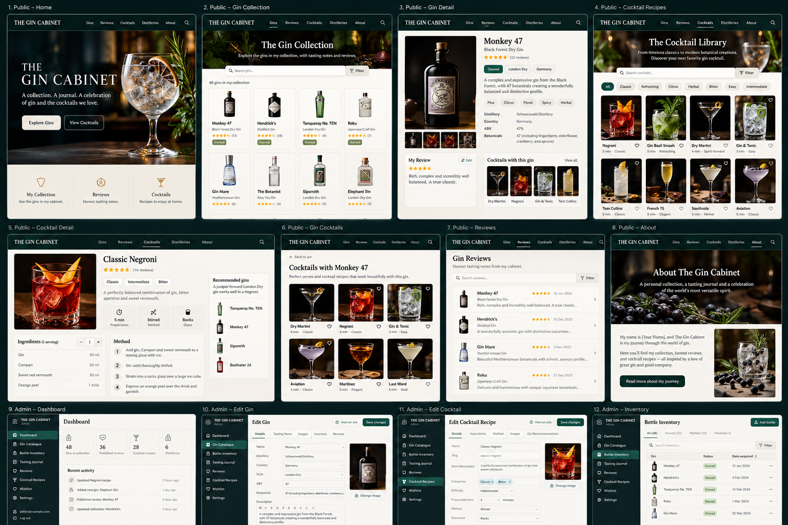

PRODUCT DESIGN • USER EXPERIENCE • TECHNICAL IMPLEMENTATION

The Gin Cabinet

Shared gin inventory, reviews, cocktails and the Gin Journal blog

Version 1.1 \| 25 October 2026 \| Implementation specification

Visual reference: 12-screen concept mockup. All displayed bottles,
values, photos and ratings are illustrative, not real collection data.

# Executive definition

One shared collection, managed by two separate administrator accounts.
The public website shows approved gin profiles, whether a gin is in the
collection, published reviews, distillery profiles and cocktail recipes.
Bottle counts, location, purchase prices, private tastings and drafts
are never public. Both administrators can manage inventory and publish
editorial content.

# 1. Scope and product rules

Version 1.1 includes the native Gin Journal blog (public articles and a
private editorial CMS) and defines Coolify as the primary production
deployment target.

| Area           | V1 requirement                                                                                              |
|----------------|-------------------------------------------------------------------------------------------------------------|
| Collection     | Exactly one shared collection; no tenant or multi-collection switcher.                                      |
| Administrators | Two distinct users with equal privileges, individual MFA, login and auditable actions.                      |
| Public content | Approved gin pages and collection status, published gin reviews, cocktail recipes and distilleries.         |
| Inventory      | Master gin record separated from individually identifiable physical bottles.                                |
| Reviews        | Individual tasting authorship and one editorial publication per review; support multiple reviews for a gin. |
| Cocktails      | Reusable ingredient master, scaled portions, preparation steps, gin pairing links and status control.       |
| Language       | English initial UI; architecture ready for localized labels and content.                                    |
| Not in V1      | Public accounts, public commenting, shopping integration, automatic bottle recognition, ingredient pantry.  |

# 2. Design language

| Token         | Specification                                                                                                          |
|---------------|------------------------------------------------------------------------------------------------------------------------|
| Palette       | Forest \#19251F; charcoal \#202020; brass \#C7A46B; cream \#F5F0E6; sage \#718173.                                     |
| Typography    | Display: editorial serif for public hero headings; UI: Aptos/Inter-style sans serif. Default body 16 px web.           |
| Spacing       | 4/8/12/16/24/32/48 px scale; 12 px form-row rhythm; cards 16–24 px padding.                                            |
| Surfaces      | Public: forest masthead, cream content; admin: forest left sidebar, warm-white workspace.                              |
| Cards         | 8–12 px radius, restrained borders, subtle hover shadows; gin cards 4:5 photography.                                   |
| Accessibility | WCAG 2.2 AA aim; focus indicators, 44 px touch targets, labels, alt text, keyboard navigation.                         |
| Responsive    | Mobile \<768 px: one-column cards, collapsible navigation; tablet 768–1199 px: 2-column; desktop ≥1200 px: 3–4-column. |
| Interactions  | Debounced search; clear loading/empty/error states; toast feedback; destructive action confirmation.                   |

# 3. Global information architecture

| Public routes                         | Administrator routes                             |
|---------------------------------------|--------------------------------------------------|
| /, /collection, /gins/\[slug\]        | /login, /admin                                   |
| /reviews, /reviews/\[slug\]           | /admin/gins, /admin/gins/new, /admin/gins/\[id\] |
| /cocktails, /cocktails/\[slug\]       | /admin/bottles, /admin/bottles/\[id\]            |
| /gins/\[slug\]/cocktails              | /admin/purchases, /admin/tastings                |
| /distilleries, /distilleries/\[slug\] | /admin/reviews, /admin/reviews/\[id\]            |
| /about, /privacy                      | /admin/cocktails, /admin/cocktails/\[id\]        |
| Sitemap.xml and robots.txt            | /admin/wishlist, /admin/media, /admin/settings   |

# 4. Public pages — exact screen behavior

## P01 Home

Layout: Full-width cinematic hero, two calls to action (Explore Gins /
View Cocktails), latest reviews, featured cocktails, collection metrics,
featured gin and footer.

Rules: Feature selection is editorial or most recently published;
metrics count public gins/reviews/recipes, never private bottles.

## P02 Collection

Layout: Search field, filter drawer/chips, sort selector, responsive
product grid with bottle photo, country, style, review rating and
Owned/Previously Owned badge.

Rules: Search name/producer/country; filter style, ABV range, origin,
botanical and rating; pagination or load-more; no prices or bottle
count.

## P03 Gin detail

Layout: Hero bottle photo, thumbnails, name, distillery, country, ABV,
botanical tags, collection status, review excerpts and linked cocktail
cards.

Rules: Hide draft review, exact quantity and purchases; related gins use
style/botanical overlap; URL uses stable slug.

## P04 Reviews

Layout: Editorial title, sort (recent/highest rated), search, filters
and list/grid of published review cards.

Rules: Review card shows author, date, score, teaser, photo and gin
link; empty state with reset filters.

## P05 Review detail

Layout: Cover, review heading, byline/date, rating, nose/palate/finish,
tonic/garnish, summary verdict and gin link.

Rules: Only published revisions are public; optional related cocktail
carousel and SEO/social image.

## P06 Cocktail library

Layout: Cinematic banner, search, filter chips for
style/flavour/difficulty/method, cocktail grid with image and duration.

Rules: Only published recipes; recommended gin matches visible by gin
relation; clear no-results state.

## P07 Cocktail detail

Layout: Photo, summary, tags, prep time, method, glassware, serving
stepper, ingredients, garnish, ordered preparation, recommended gins.

Rules: Ingredient amounts scale by serving count (1–12); garnish count
scaled where numeric; non-scalable instructions unchanged.

## P08 Distilleries

Layout: Directory of distilleries and producer detail with origin,
description, website and linked public gins.

Rules: Only distilleries linked to public gins by default; external
links clearly marked.

## P09 About / privacy

Layout: Editorial origin story, tasting methodology, two reviewer
profiles if desired, contact method and privacy information.

Rules: No administrator identifiers or emails displayed without explicit
consent.

# 5. Administrator pages — exact screen behavior

## A01 Dashboard

Layout: Four stat tiles (unique gins, physical bottles, open bottles,
inventory value), recent activity, open drafts and quick actions.

Rules: Value = sum of purchase-line bottle acquisition cost, with
unknown cost excluded and explicitly shown; public numbers separate from
private.

## A02 Gin catalogue

Layout: Searchable data table/grid; add/edit form with name, slug,
edition, distillery, country, type, ABV, botanicals, images, public
visibility.

Rules: Validate 0 \< ABV ≤ 100 and gin identity uniqueness; keep
SKU/product independent of bottle records; slugs unique.

## A03 Bottle inventory

Layout: List and detail with bottle ID, gin, size ml,
sealed/open/empty/gifted/disposed, estimated level, shelf, acquisition,
comments.

Rules: Each physical bottle has its own UUID; preserve history; status
transitions recorded; opening date and finished date optional.

## A04 Purchases

Layout: Purchase form with retailer, date, currency, reference, receipt,
multiple purchase lines and per-bottle costs.

Rules: Supports quantity purchases creating N bottle records; no
mandatory price for gifted bottles; totals include currency information.

## A05 Tasting journal

Layout: List by gin/author/date; detail form with context,
nose/palate/finish, flavor sliders 0–5, overall rating, tonic, garnish,
private notes.

Rules: Each tasting belongs to one admin and one gin, can link to a
specific physical bottle optionally; never public by default.

## A06 Review editor

Layout: Draft list, rich-text blocks for intro/notes/verdict, author,
canonical gin, images, rating, SEO fields, publish/withdraw.

Rules: Explicit transition draft→ready→published→archived; revision
history; save conflicts show both versions.

## A07 Cocktail editor

Layout: Recipe catalogue, detail tabs: basics / ingredients / steps /
imagery / gin pairings / SEO / publishing.

Rules: Ingredient ordered rows store unit+quantity; method choices
build/shake/stir/blend; recommended gin priority and explanation.

## A08 Wishlist

Layout: List priority, target price, gin catalogue link, notes, added by
and purchased state.

Rules: Wishlist private; convert purchased entry to acquisition without
deleting source notes.

## A09 Media library

Layout: Upload/dropzone, image preview, alt text, credit/license and
usage references.

Rules: Restrict MIME/size, process images and strip EXIF GPS; block
deletion when still referenced or soft-delete.

## A10 Settings & admins

Layout: Public branding/logo, site metadata, default gin visibility,
contact fields; two admin profiles/password/MFA and audit viewer.

Rules: No public signups; recovery flow for lost passwords; second admin
cannot silently reset the first without confirmation and audit.

# 6. Shared workflows

## Add gin and bottle

Search existing gin → select or create master → add bottle size,
purchase/source and location → save → record audit event → optional mark
gin public.

## Consume bottle

Select bottle → mark Opened → set approximate remaining volume
periodically → mark Empty when finished; retain records for history.

## Publish review

Create private tasting → start editorial draft for gin → write review →
preview public format → publish explicitly → public API and sitemap
update.

## Publish cocktail

Create recipe → add reusable ingredients and amounts → order method
steps → upload photo → attach recommended gin(s) → preview → publish.

## Two-person edit conflict

Each editable record includes version/updated_at; stale PATCH returns
409 with current record and diff; force-overwrite needs deliberate
confirmation.

## Public gin visibility

gin_products.public_visible flag governs collection presence; review and
recipe publication independently checked; unpublished gin association
must not leak private product data.

## Imports and export

CSV import with preview/dedupe/validation; data export includes gins,
bottles, purchases, tastings, reviews, recipes; backups include media
and database.

# 7. Data model & constraints

| Entity                           | Essential fields / relationships                                                                                   |
|----------------------------------|--------------------------------------------------------------------------------------------------------------------|
| users                            | id, username unique, email unique, password_hash, totp_secret_encrypted, enabled, created_at, last_login_at        |
| collections                      | id, name, owner-independent configuration (seed single row)                                                        |
| distilleries                     | id, slug, name, country, region, description, website, visibility                                                  |
| gin_products                     | id, slug unique, brand, name, edition, style, abv numeric(5,2), distillery_id, description, public_visible         |
| botanicals + gin_botanicals      | botanicals unique name; junction gin_id, botanical_id                                                              |
| bottles                          | id, collection_id, gin_id, size_ml, status, remaining_ml, shelf, purchase_line_id, opened_at, finished_at, version |
| purchases + purchase_lines       | purchase id, date, retailer, currency, receipt; line id, gin_id, unit_price, quantity, size_ml                     |
| tastings                         | id, gin_id, author_id, bottle_id nullable, tasted_at, scores JSONB or structured fields, notes, privacy            |
| reviews + review_revisions       | id, gin_id, author_id, slug, status, rating, editorial text, published_at; revision snapshot + actor               |
| cocktail_recipes                 | id, slug, title, intro, method, glassware, prep_minutes, difficulty, servings_base, status, author_id              |
| ingredients + recipe_ingredients | ingredient id, canonical name, category; recipe ingredient quantity decimal, unit, note, sort_order, optional      |
| cocktail_gin_recommendations     | recipe_id, gin_id, priority, pairing_note; unique composite pair                                                   |
| media_assets                     | id, path, mime, dimensions, alt, credit, rights, uploaded_by, created_at                                           |
| wishlist_items                   | id, gin_id nullable, text, priority, target_price, currency, notes, status                                         |
| audit_events                     | id, actor_id, entity_type, entity_id, action, timestamp, before/after safe JSON summary                            |

Core constraints: bottle remaining_ml between 0 and size_ml; public
content requires published status; foreign keys indexed; use UTC
timestamps, ISO dates and integer minor currency units or precise
NUMERIC. Normalize ingredient units (ml, cl, g, tsp, piece, dash) and
avoid arbitrary string multiplication.

# 8. API contracts

> GET /api/v1/public/gins?search=&style=&country=&page=  
> GET /api/v1/public/gins/{slug}  
> GET /api/v1/public/reviews\[/{slug}\]  
> GET /api/v1/public/cocktails\[/{slug}\]  
> GET /api/v1/public/distilleries\[/{slug}\]  
> POST /api/v1/auth/login \| POST /api/v1/auth/logout  
> GET /api/v1/auth/session \| POST /api/v1/auth/mfa/verify  
> GET/POST/PATCH /api/v1/admin/gins\[/{id}\]  
> GET/POST/PATCH /api/v1/admin/bottles\[/{id}\]  
> GET/POST/PATCH /api/v1/admin/purchases\[/{id}\]  
> GET/POST/PATCH /api/v1/admin/tastings\[/{id}\]  
> GET/POST/PATCH /api/v1/admin/reviews\[/{id}\]  
> POST /api/v1/admin/reviews/{id}/publish  
> GET/POST/PATCH /api/v1/admin/cocktails\[/{id}\]  
> POST /api/v1/admin/cocktails/{id}/publish  
> POST /api/v1/admin/media \| GET /api/v1/admin/audit

API rules: versioned JSON contracts, pagination metadata, field-level
response DTOs, validation errors with stable codes, 401 for
unauthenticated, 403 forbidden, 404 for unpublished public items and 409
for optimistic-lock conflicts. All admin write routes require session +
CSRF protection. Never return private inventory fields from public
endpoints.

# 9. Security, privacy and availability

- Password hashes: Argon2id; enforce strong passphrases; separate
  administrator credentials; MFA via TOTP and recovery codes stored
  hashed.

- HTTPS only; session tokens in Secure/HttpOnly/SameSite cookies; short
  idle and absolute lifetimes; session revoke and login throttling.

- CSRF tokens on mutating requests; strict origin checks; server-side
  authorization for every admin request; safe redirects.

- Uploaded images: size and extension limits, decode/re-encode, safe
  filenames, SVG disabled by default, EXIF GPS removal,
  content-security-policy.

- PostgreSQL not public; application database user least privilege;
  secrets via environment/secret management, not repository.

- Nightly encrypted off-host backup for DB and media, retention policy,
  and monthly test restore; document RPO/RTO as operational targets.

- Audit log on publication, sign-in, inventory changes and deletions;
  private details excluded from public logs and analytics.

- Privacy notices, cookie-consent review if non-essential analytics
  introduced; no public profiles required.

- Structured logging, health endpoints, dependency scanning and periodic
  OS/containers updates.

# 10. Deployment and project structure

> gin-cabinet/  
> apps/web/ \# Next.js public site, admin and blog UI  
> apps/api/ \# FastAPI, services, authorization and content publishing  
> packages/shared/ \# Shared types, validation contracts and utilities  
> infra/ \# Dockerfiles, compose, migrations and backup docs  
> docs/ \# Product, security, operations and UX documentation

Deployment standard: Coolify on one Ubuntu VPS manages the Next.js web
application, FastAPI backend and private PostgreSQL database. Use
Coolify reverse-proxy routing and TLS, Cloudflare DNS as configured,
off-host backups for database and uploaded media, health checks, and
source-controlled Docker builds. The Docker Compose configuration
remains portable outside Coolify.

# 10A. The Gin Journal: public blog and private CMS

## Product purpose

The Gin Journal is a native editorial module, not a separate WordPress
instance. It shares authentication, media management, design tokens,
content discovery, audit events and publication infrastructure with gin
reviews and cocktail recipes. Both administrators can create, edit,
schedule and publish articles in the one shared website.

## Public UI: B01 Blog landing

Route: /blog. Header carries the same public navigation with
Journal/Blog highlighted. Editorial hero displays one featured published
article with large landscape image, category, title, excerpt, author and
publication date. Below: latest stories grid (3 columns desktop, 2
tablet, 1 mobile), category chips, keyword search, featured story,
pagination and an empty state. Cards show image in 4:3, category,
headline, excerpt, byline and estimated reading time.

## Public UI: B02 Article detail

Route: /blog/\[slug\]. Article masthead contains category, H1 title,
standfirst, hero image/credit, named author, publication and update
dates, optional reading time. Body uses a comfortable narrow text column
with H2/H3, paragraph, inline image/caption, quotation, lists, links and
referenced gin/cocktail cards. End-of-article includes relevant gins,
cocktails, related stories, and back-to-journal navigation. Mobile view
stacks article metadata and images without horizontal scrolling.

## Public UI: B03 Category and tag pages

Routes: /blog/category/\[slug\] and /blog/tag/\[slug\]. Show descriptive
heading, matching published articles, pagination and a canonical URL.
Suggested editable categories: Gin Stories, Distillery Visits, Gin
Guides, Cocktail Culture, My Collection, Events & Tastings.

## Admin UI: A11 Article list

Route: /admin/blog. Table includes image, title, category, author,
publication status, published/scheduled date, last editor and last
updated. Search; filter by status/category/author; bulk archive only
with confirmation; actions: new, edit, preview, duplicate,
publish/unpublish, archive. Status badge must never be mistaken for a
live-public indicator.

## Admin UI: A12 Blog editor

Routes: /admin/blog/new and /admin/blog/\[id\]/edit. Form fields: title,
slug, summary, category, tags, author, featured image and alt text, SEO
title, meta description, social image, related gin/review/cocktail
references and scheduled publication time with timezone shown. Block
editor supports headings, paragraphs, lists, quotations, safe links and
images with captions; embed cards by reference ID instead of arbitrary
HTML. Provide Save draft, Preview, Schedule, Publish and Archive actions
with explicit confirmation where appropriate. Autosave and optimistic
concurrency protection should not silently publish content.

## Admin UI: A13 Taxonomy and publishing

Route: /admin/blog/categories. Manage category name, slug, description
and optional ordering; disallow duplicate slugs. Publication state
machine: draft -\> scheduled or published -\> archived (with published
-\> draft/unpublish supported). An idempotent scheduled publishing job
verifies schedule and publishes atomically. Review revisions save before
replacements and preserve author/editor attribution.

## Blog UI design details

Use the established dark forest-green masthead, ivory article surface,
brass accents and editorial serif headings. Content max-width
approximately 720 px for reading; page shell approximately 1200 px.
Featured hero ratio 16:9; listing thumbnails 4:3; mobile 1-column
listing; keyboard-accessible navigation and editor controls. Images must
have alt text or be explicitly decorative. Use consistent
skeleton/loading, no-result, validation-error and unsaved-change
patterns.

## Blog data entities

- \`blog_posts\`: UUID, slug(unique), title, excerpt, body_blocks JSON,
  status, author_user_id, category_id, hero_media_id, featured,
  created_at, updated_at, published_at, scheduled_at, edited_by_user_id,
  row_version.

- \`blog_categories\`: UUID, name, slug(unique), description,
  display_order. \`blog_tags\`: UUID, name, slug(unique);
  \`blog_post_tags\`: join relation.

- \`blog_post_revisions\`: immutable post_id, revision_number,
  edited_by, saved_at, snapshot. \`blog_post_relations\`: post_id,
  entity_kind (gin/review/cocktail/post), entity_id, position.

- Indexes on status + publication timestamp, slug and category;
  foreign-key constraints and audit trail for publication. Public
  queries require status=published and published_at \<= current UTC
  time.

## Blog API contracts

GET /api/v1/public/blog?search=&category=&tag=&page=  
GET /api/v1/public/blog/{slug}  
GET /api/v1/public/blog/categories  
POST /api/v1/admin/blog  
GET /api/v1/admin/blog?status=&search=  
PATCH /api/v1/admin/blog/{id} (If-Match/version required)  
POST /api/v1/admin/blog/{id}/publish  
POST /api/v1/admin/blog/{id}/schedule  
POST /api/v1/admin/blog/{id}/unpublish  
GET /api/v1/admin/blog/{id}/revisions

## Search, syndication and privacy

Expose only published articles in public search, sitemap, robots-allowed
routes and /blog/rss.xml. Each article has metadata, Open Graph image,
structured Article data and canonical URL. Ensure draft preview uses an
authenticated session or a short-lived signed preview token. Avoid
external embeds by default; sanitize rich text at input and output. Do
not include private administrator emails, unpublished notes or media
files in public results.

# 10B. Coolify deployment and operating runbook

## Deployment topology

Coolify project: the-gin-cabinet; environment: production. Deploy web
(Next.js) and api (FastAPI) as separately built services from the same
Git repository; provision a private Coolify PostgreSQL resource. All
internal database and service traffic travels over the private Docker
network. Only frontend is public; proxy /api to the API service through
the same origin. Admin routes are /admin with authentication, MFA and
authorization. Persistent media uses a dedicated volume, with migration
to S3-compatible storage possible later.

## DNS, TLS and edge

Set gincabinet.example.com as a placeholder public domain; configure the
actual domain in Coolify and Cloudflare DNS. Coolify reverse proxy
routes / and /api and issues/uses HTTPS certificates according to chosen
proxy configuration. If Cloudflare proxy is enabled, enforce Full
(strict) TLS to origin, use appropriate headers and verify
real-client-IP trust boundaries. Never expose the database or internal
API service directly to the Internet.

## Repository and build conventions

Use Dockerfiles with pinned runtime major versions, multi-stage builds,
non-root runtime users, production-only dependencies and /health
endpoints. Store docker-compose.yml for local and emergency deployment
portability. Environment variable templates contain placeholders only;
passwords, secret keys, OAuth credentials and database URL values live
in Coolify secrets and never in Git.

## Deployment workflow

1.  1\. Create production project and private PostgreSQL resource;
    configure database, roles, storage and backup schedule.

2.  2\. Connect the Git repository and define two application services
    with Dockerfile build contexts and health checks.

3.  3\. Configure internal API -\> database connection, frontend -\> API
    internal routing and one public domain.

4.  4\. Run Alembic migrations as a controlled one-time deployment job
    before switching traffic; make rollback procedures explicit.

5.  5\. Provision the two administrator accounts through a secure
    bootstrap command; force credential enrollment and MFA.

6.  6\. Upload representative media, publish test
    gin/review/cocktail/blog posts, validate public/private permission
    boundaries.

7.  7\. Enable off-host PostgreSQL and media backups; conduct a
    restoration test before going live.

8.  8\. Configure health alerts, logs, update cadence, security patches
    and deployment rollback instructions.

## Backup, recovery and persistent storage

Back up PostgreSQL using scheduled logical backups or consistent
snapshots; separately back up uploaded images/media volume to off-host
S3-compatible storage. Verify retention, encryption and restorability. A
database-only backup does not restore media. Document recovery
objectives and test restores in an isolated environment. Avoid storing
irreplaceable state in application container writable layers.

## Operational sizing and scaling

Starting capacity guidance (not a guarantee): 2-4 vCPU, 4-8 GB RAM and
at least 60 GB SSD for a small personal deployment; prefer 8 GB if CI
builds run on the same host. Assess storage demand from photos and
backup retention. Later scale by separating database or media storage,
using managed PostgreSQL or object storage, without redesigning the
public API.

## Version 1.1 acceptance additions

☐ Both admins can create/edit/schedule/publish/unpublish blog posts; all
operations are attributed in audit events.

☐ Blog listing, detail, category and tag pages show only published
entries; unpublished posts yield 404 publicly.

☐ Related gin/review/cocktail cards resolve correctly without leaking
unpublished associated records.

☐ Scheduled publishing respects UTC storage and explicitly shown editor
timezone.

☐ Public site, API, database and media survive a container replacement
and a documented restoration.

☐ Coolify deployment and Git-based update process succeed with health
checks and secure secret storage.

☐ Article page metadata, mobile layout, accessible images and
RSS/sitemap output pass acceptance tests.

# 11. Validation and acceptance tests

☐ Both admins can authenticate and modify the same collection, with
distinct activity attribution.

☐ A gin can have multiple physical bottles, each with different size,
price and state.

☐ Opening, finishing or gifting a bottle preserves inventory history and
statistics.

☐ Public pages disclose only explicitly approved gin profiles and
published editorial content.

☐ A draft review or cocktail recipe returns 404 from unauthenticated
public endpoints.

☐ Review publication and unpublication correctly updates listing and
canonical pages.

☐ Cocktail serving scaling changes numerical ingredient quantities and
not method text.

☐ Cocktail-gin recommendations on gin profile and recipe page stay
consistent.

☐ Concurrent edits trigger a meaningful 409 conflict flow rather than
silent overwrites.

☐ CSV import identifies duplicates and records rejected rows with
actionable reasons.

☐ Backup restoration is performed successfully into isolated test
environment.

☐ Keyboard, mobile layout, metadata/SEO, image alt text, pagination and
empty states pass QA.

# 12. Delivery phases and decisions

| Phase            | Outputs                                                                                      |
|------------------|----------------------------------------------------------------------------------------------|
| 1 Foundation     | Design tokens, auth, permissions, database, Docker, sidebar/header, admin login.             |
| 2 Inventory      | Gin catalogue, distilleries, bottle history, purchases, wishlist, import/export.             |
| 3 Editorial      | Tastings, reviews, image management, editorial workflow, preview.                            |
| 4 Cocktails      | Ingredients, recipe editor, serving scaler, matching recommendations, public recipe library. |
| 5 Public website | Home, collection, gin profiles, reviews, distilleries, about, SEO.                           |
| 6 Launch QA      | Security, tests, backup restore, accessibility, performance, deployment runbook.             |

Pending product choices (non-blocking defaults): review model = one
shared editorial publication, authored by one admin per review;
individual private tastings retained. Public owned badge is enabled only
where gin is public_visible. English is the first language. Recipes show
measurements in metric units.
